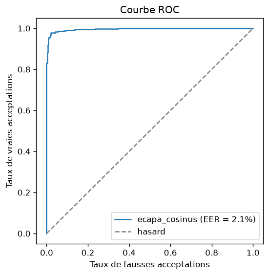
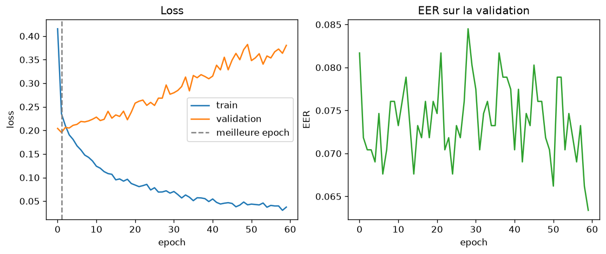
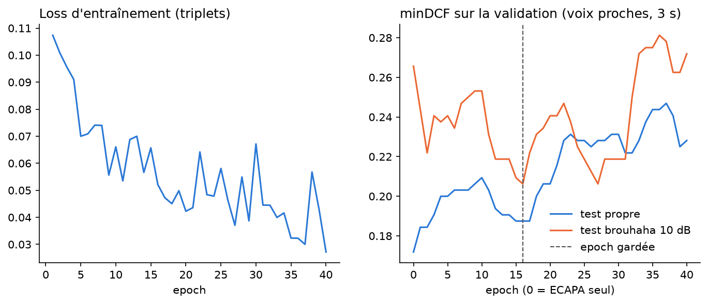
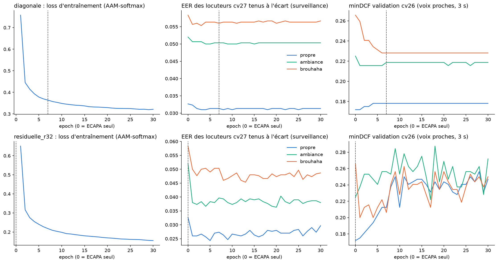
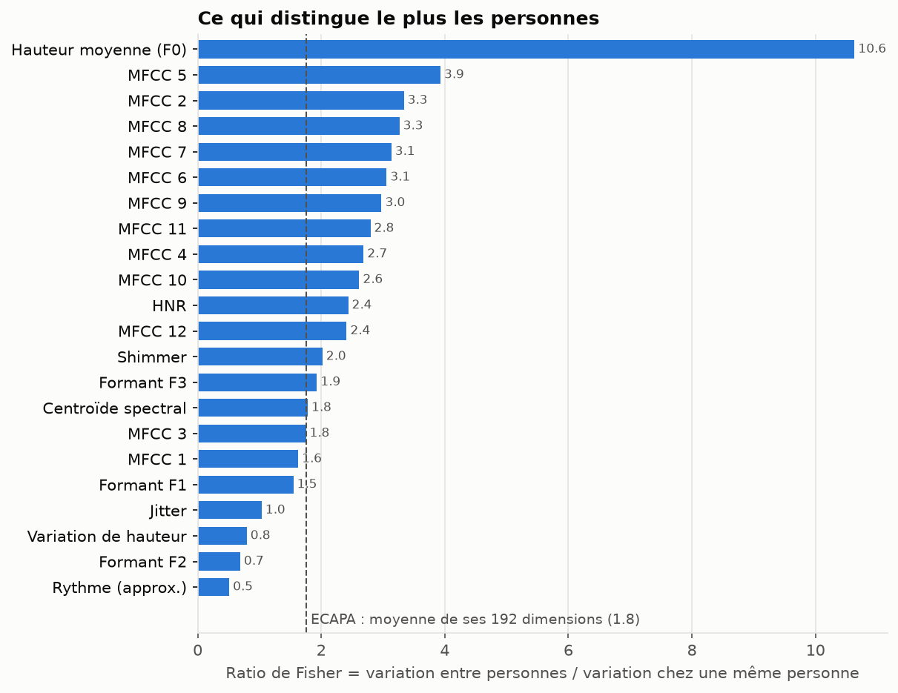
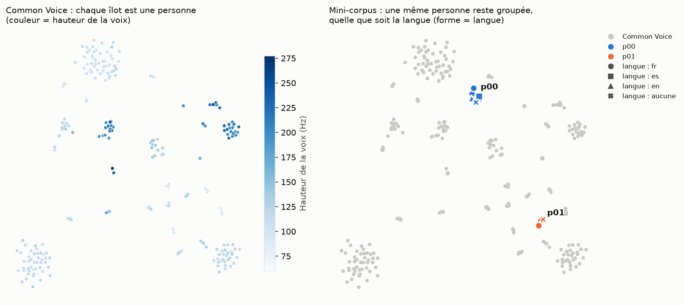
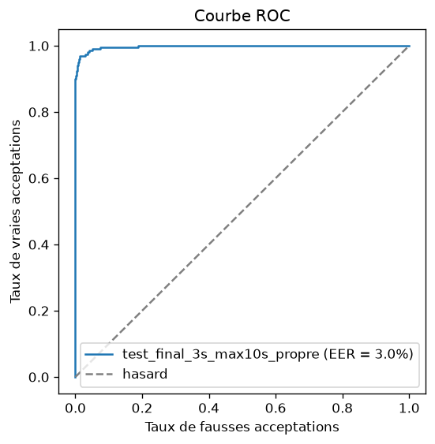

# Rapport technique — Piscine IA Lab : Voiceprint

Voiceprint est un système de vérification du locuteur à partir d'enregistrements vocaux. Il détermine si deux voix appartiennent à la même personne. Il est conçu pour fonctionner sur des personnes jamais entendues pendant le développement, quels que soient leur langue, les mots prononcés et leur genre. Une seule personne s'enrôle à la fois ; ensuite, autant de personnes que l'on veut peuvent se faire tester, l'une après l'autre, sans nouvel enrôlement.

## Résumé

Ce projet a consisté à réaliser un système qui décide si deux enregistrements viennent de la même personne et qui fonctionne sur des personnes jamais entendues. Notre démarche a été de comparer une baseline classique (MFCC, cosinus, classifieurs, petit réseau) à un modèle pré-entraîné, ECAPA-TDNN, sur les mêmes paires et avec la même fonction d'évaluation. Au fil du projet, nous avons essayé diverses méthodes d'amélioration. Certaines se sont révélées concluantes, d'autres n'ont pas amélioré le système.

Le modèle ECAPA divise l'erreur par plus de trois : une EER de 2,1 % contre 6,8 % pour la meilleure baseline. Trois réglages ont été mesurés par ablation : la normalisation, la durée d'enrôlement et la robustesse au bruit. Deux versions de metric learning ont été essayées : la première a sur-appris (overfitting), la seconde n'a pas apporté de gain fiable. Elles n'ont donc pas été retenues.

Nous avons ensuite construit un banc d'essai (banc v3) où chaque voix est préparée exactement comme dans l'application. Cela nous a fait passer d'un seuil de 0,362 à 0,416 pour un enrôlement de 3 s. Ces réglages, choisis sur 28 personnes, ont ensuite été vérifiés sur 290 nouvelles personnes (Common Voice 27.0). Cette vérification a conduit à un dernier ajustement : un seuil de **0,428** (3 s), 0,447 (5 s) et 0,482 (10 s), pour garantir au plus 1 % d'imposteurs acceptés sur toutes les validations.

Enfin, le **test final**, réalisé une seule fois sur 29 personnes jamais utilisées, donne pour un enrôlement de 3 s : une **EER de 3,0 %**, **0 % d'imposteurs acceptés** et **11,6 % de vraies personnes refusées**. En conditions réelles, avec l'application finale, 22 essais sur 24 de l'auteur ont été acceptés, en trois langues.

## 1. Problème et protocole

**Tâche.** Il s'agit d'une vérification : une personne s'enrôle avec un seul enregistrement, puis chaque nouvel enregistrement est comparé à cette empreinte. Le système répond « même personne » si le score de correspondance est au-dessus du seuil, « autre personne » sinon.

**Contrainte de la démo.** Une personne inconnue s'enrôle en 3 s environ (5 s ou 10 s sont aussi possibles). Ensuite, 5 à 10 personnes aux profils variés (selon leur âge, leur genre ou leur langue) parlent chacune environ 7 à 10 s. Le système doit reconnaître la personne enrôlée et ne pas réagir aux autres. À savoir : l'erreur la plus grave est d'accepter un imposteur.

**Données.** Le détail est dans la [fiche des corpus](FICHE_CORPUS.md).

- **Common Voice 26.0, français de France** : 5 282 clips, 7,45 h, 142 locuteurs, découpés **par locuteur** en 85 (train, 4,79 h), 28 (validation, 0,84 h) et 29 (test, 1,82 h).
- **Common Voice 27.0, français (sous-ensemble)** : 945 locuteurs, séparés en environ 655 pour l'entraînement (metric learning) et 290 pour une grande validation. Aucun d'entre eux n'appartient à la validation ou au test cv26.
- **Mini-corpus** : 2 personnes, 14 enregistrements (plusieurs langues, distance au micro), avec consentement.

**Mesures**

- **EER** : le taux d'erreur au seuil où les fausses acceptations égalent les faux rejets.
- **minDCF** : un coût, de 0 (parfait) à 1 (aussi mauvais que tout refuser), calculé pour 5 % de vraies tentatives. Il pénalise surtout les imposteurs acceptés.
- **AUC** : la probabilité qu'un essai de la vraie personne obtienne un meilleur score qu'un essai d'imposteur. 1 = parfait, 0,5 = hasard. Exemple : avec une AUC de 0,99, si on tire au hasard un essai de la vraie personne et un essai d'imposteur, le premier a le meilleur score dans 99 % des cas.
- **Courbe ROC** : elle montre, pour tous les seuils possibles, le taux de vraies personnes acceptées en fonction du taux d'imposteurs acceptés. Plus elle colle au coin en haut à gauche, meilleur est le système. C'est comme régler la sensibilité d'une alarme : chaque point de la courbe correspond à un réglage.
- **FRR@FA1%** : la part de vraies personnes refusées quand on n'accepte que 1 % d'imposteurs. C'est le réglage de la démo.

**Règles**

- Tous les réglages (les seuils, la calibration, les choix d'epoch, la normalisation) sont faits sur la validation.
- Le test reste fermé jusqu'à l'évaluation finale.
- Toutes les approches sont comparées sur les mêmes paires.

**Négatives.** Comparer deux personnes au hasard est trop facile, notamment quand c'est un homme à voix grave contre une femme à voix aiguë. Le banc v2 ajoute donc des imposteurs difficiles : le quart des couples de locuteurs dont la **hauteur de voix (F0)** est la plus proche (écarts de 0 à 14 Hz). La plupart des chiffres de ce rapport portent sur ces voix proches.

## 2. Tableau comparatif des approches

Paires de validation v1 : 710 paires (355 positives, 355 négatives), 28 locuteurs. Ce sont les mêmes paires pour toutes les lignes.

| Approche | Représentation | Score | EER | minDCF | AUC |
|---|---|---|---|---|---|
| Baseline 1 | 20 MFCC → moyenne + écart-type (40 nombres) | cosinus brut | 19,0 % | 0,676 | 0,890 |
| Baseline 2 | + standardisation (moyenne et écart-type du train) | cosinus | 11,0 % | 0,318 | 0,964 |
| Baseline 3 | paire → \|a − b\| | régression logistique | 12,3 % | 0,563 | 0,954 |
| Baseline 4 | paire → \|a − b\| et a × b | régression logistique | 8,0 % | 0,504 | 0,968 |
| Baseline 5 | paire → \|a − b\| et a × b | SVM | 6,8 % | 0,530 | 0,963 |
| Baseline 6 | paire → \|a − b\| et a × b | MLP PyTorch | 7,2 % | 0,332 | 0,976 |
| **ECAPA-TDNN** | empreinte pré-entraînée | cosinus | **2,1 %** | **0,169** | **0,996** |

*Figure 1 — Courbe ROC d'ECAPA sur les paires de validation v1.*

*Figure 2 — Courbes d'entraînement du petit réseau (MLP) : loss d'entraînement et de validation, EER de validation par epoch.*

**Lecture des approches**

- La **standardisation** compte énormément pour la baseline (19,0 % → 11,0 %). Sans elle, le MFCC 0, qui mesure le volume, écrase tous les autres coefficients dans le cosinus.
- Apprendre sur **les paires** aide (6,8 %). Mais les classifieurs restent limités par la représentation (40 statistiques globales uniquement).
- **ECAPA** a déjà appris sur environ 7 000 personnes ce qui distingue les voix. Score moyen si c'est la même personne : 0,688 ; personnes différentes : 0,147.

## 3. Ablations

Chaque tableau ne change **qu'un facteur à la fois**, sur les mêmes paires.

### 3.1 Normalisation des empreintes ECAPA (banc v2, voix proches)

| Réglage | Entier : EER / minDCF | 3 s : EER / minDCF | 3 s : FRR@FA1% |
|---|---|---|---|
| Cosinus brut | 4,2 % / 0,225 | 4,2 % / 0,272 | 12,2 % |
| **+ soustraction de la moyenne du train** | **2,7 % / 0,141** | **2,5 % / 0,172** | **8,1 %** |
| + AS-norm | 2,3 % / 0,328 | 3,1 % / 0,337 | 27,5 % |
| + moyenne + AS-norm | 3,0 % / 0,341 | 2,7 % / 0,387 | 37,8 % |

**Décision :** suite à ces résultats, on a gardé la **soustraction de la moyenne**, mais l'**AS-norm** a été écartée. L'AS-norm améliore parfois l'EER, mais elle fait monter les scores de quelques imposteurs. Pour n'accepter que 1 % d'imposteurs, il faut alors refuser beaucoup plus de vraies personnes.

**Pourquoi la soustraction aide :** toutes les empreintes partagent une composante commune (la langue, le type de micro, leur origine : Common Voice). La retirer recentre les comparaisons sur ce qui est propre à chaque personne et ce qui fait leur différence.

### 3.2 Durée de l'audio

Durée du test avec ECAPA (banc v2, voix proches) :

| Test | EER | minDCF |
|---|---|---|
| Clip entier (environ 5 s) | 4,2 % | 0,225 |
| 3 s | 4,2 % | 0,272 |
| 2 s | 4,4 % | 0,272 |

Durée de l'enrôlement (un seul bloc de parole, moyenne soustraite, test 3 s, voix proches) :

| Enrôlement | EER | minDCF | FRR@FA1% | Seuil FA1% |
|---|---|---|---|---|
| 3 s | 2,6 % | 0,126 | 3,6 % | 0,362 |
| 5 s | 2,0 % | 0,136 | 4,2 % | 0,356 |
| 8 s | 1,1 % | 0,112 | 1,0 % | 0,372 |
| 10 s | 1,0 % | 0,094 | 0,0 % | 0,378 |

*Ce tableau vient d'un protocole propre à cette étape : enrôlement fait de plusieurs clips recollés, tests sur les autres clips de la personne, imposteurs = tous les clips des autres personnes. Ses chiffres ne sont pas directement comparables à ceux du banc v3 (section 3.4).*

**Lecture des résultats**

- Plus l'enrôlement est long, plus le système est fiable. Mais 3 s reste globalement fiable et utilisable.
- Calculer l'empreinte d'un bloc ou faire la moyenne de morceaux de 3 s donne des résultats quasi identiques. On garde le bloc, plus simple et plus proche de la situation réelle le jour de la démo.
- 2 s est abandonné : la dégradation est trop forte pour un gain de temps négligeable.
- **Choix : on se concentre sur 3 s, car les résultats sont bons (5 s et 10 s restent disponibles).**

### 3.3 Bruit (banc v2, enrôlement 3 s propre, test 3 s bruité, voix proches, seuil de l'époque : 0,362)

| Condition | EER | minDCF | Vraie personne refusée | Imposteur accepté |
|---|---|---|---|---|
| Propre | 2,5 % | 0,172 | 5,9 % | 1,9 % |
| Ambiance 20 / 10 / 5 dB | 2,2 / 3,1 / 4,7 % | 0,188 / 0,228 / 0,316 | 7,5 / 11,2 / 20,0 % | 1,6 / 1,2 / 0,9 % |
| Brouhaha 20 / 10 / 5 dB | 3,3 / 7,8 / 11,9 % | 0,162 / 0,337 / 0,447 | 7,8 / 23,1 / 41,6 % | 0,9 / 0,9 / 0,3 % |

- L'« ambiance » est un bruit de fond continu (bruit rose : ventilation, salle). Le « brouhaha » est fait de 4 voix de locuteurs de train superposées.
- **Observation :** le bruit fait baisser tous les scores. Avec du bruit, on accepte donc *moins* d'imposteurs, mais en contrepartie on refuse *beaucoup plus* de vraies personnes. Le système préfère rester prudent.
- Le brouhaha est le pire : comme il est fait de voix, il brouille précisément ce que le modèle écoute.
- **Conséquence pour le jour de la démo :** une salle calme, un micro proche et un test allant jusqu'à 10 s garantissent une décision plus sûre.

### 3.4 Préparation de la voix (banc v2 → banc v3)

Le banc v2 prenait le milieu du clip brut, silences compris. La démo, elle, retire tous les silences et les pauses, puis garde les N premières secondes de parole selon la durée d'enrôlement choisie. Les seuils mesurés sur le banc v2 ne correspondaient donc pas exactement aux conditions du jour J.

Le banc v3 reprend donc les **mêmes 960 paires** et prépare chaque voix avec la même fonction que l'application :

- enrôlement de 3, 5 ou 10 s de parole ;
- test de 3 s ou jusqu'à 10 s ;
- bruit ajouté avant le retrait des silences, comme dans une vraie salle.

**Mais alors, quelle moyenne soustraire ?** (enrôlement 3 s, voix proches, moyenne sur 6 tests : 2 durées × 3 conditions)

| Moyenne soustraite | minDCF moyen | FRR@FA1% moyen |
|---|---|---|
| Train cv26, clips bruts (ancienne) | 0,222 | 8,9 % |
| **Train cv26, préparée comme l'application** | **0,217** | **8,2 %** |
| cv27, 945 locuteurs | 0,235 | 10,5 % |

La moyenne fabriquée avec la même recette que l'application est la meilleure. Celle de cv27, qui correspond aux données de Common Voice 27.0, dégrade les résultats sur cv26. À l'inverse, lors de la grande validation (section 6), cette même moyenne cv27 était la meilleure sur les personnes cv27. C'est la leçon qu'on en tire : une moyenne doit ressembler aux voix qu'elle normalise.

**Résultats du banc v3** (moyenne « cv26 préparée comme l'application », voix proches)

| Enrôlement | Test | Condition | EER | minDCF | FRR@FA1% | Seuil FA1% |
|---|---|---|---|---|---|---|
| 3 s | 3 s | propre | 2,2 % | 0,175 | 5,6 % | 0,416 |
| 3 s | ≤ 10 s | **propre** | **1,9 %** | **0,172** | **5,3 %** | 0,416 |
| 3 s | ≤ 10 s | ambiance 10 dB | 2,8 % | 0,194 | 5,0 % | 0,343 |
| 3 s | ≤ 10 s | brouhaha 10 dB | 5,9 % | 0,241 | 11,3 % | 0,298 |
| 5 s | ≤ 10 s | propre | 2,0 % | 0,156 | 3,7 % | 0,447 |
| 10 s | ≤ 10 s | propre | 1,9 % | 0,153 | 3,4 % | 0,482 |

On continue d'évaluer 5 et 10 s pour suivre l'évolution, mais on reste concentrés sur 3 s, le temps visé à la fin du projet. Le tableau complet est dans `results/banc_v3.csv`.

## 4. Metric learning

L'idée était d'ajouter au-dessus d'ECAPA gelé une petite couche apprise, qui rapproche les empreintes d'une même personne et éloigne celles de personnes différentes, en simulant les conditions de la démo : extraits de 3 s de phrases différentes, avec ou sans bruit. La couche part de « ne rien changer » : à l'epoch 0, on retrouve exactement ECAPA. Elle n'est gardée que si elle améliore la validation.

### 4.1 Version 1 : triplet loss, 85 locuteurs

- Couche résiduelle 192 → 192 (environ 37 000 paramètres).
- **Triplet loss** « batch-hard », marge 0,2. Dans chaque lot de 16 personnes × 6 empreintes, chaque ancre est comparée à son positif le plus éloigné et à son négatif le plus proche.
- Données : 85 locuteurs de train cv26 × 6 versions (2 propres, ambiance et brouhaha à 20 et 10 dB), soit 6 030 empreintes. 40 epochs.

| Voix proches, 3 s / 3 s | minDCF ECAPA → + couche | FRR@FA1% ECAPA → + couche |
|---|---|---|
| Propre | 0,172 → 0,188 | 8,1 % → 9,1 % |
| Ambiance 10 dB | 0,225 → 0,262 | 12,8 % → 10,0 % |
| Brouhaha 10 dB | 0,266 → 0,206 | 12,2 % → 19,4 % |

**Évolution au fil des epochs.** Le tableau ci-dessous vient d'une **relance du script** (13/11), identique dans son principe au premier lancement. Le premier lancement donnait des valeurs proches : loss de 0,07 dès l'epoch 5, minDCF propre de 0,244 à l'epoch 35, epoch gardée 16. La relance n'a gardé aucune epoch : l'epoch 0, c'est-à-dire ECAPA seul, restait la meilleure.

| Epoch | 0 (ECAPA seul) | 5 | 10 | 15 | 20 | 25 | 30 | 35 | 40 |
|---|---|---|---|---|---|---|---|---|---|
| Loss d'entraînement | — | 0,082 | 0,084 | 0,059 | 0,052 | 0,054 | 0,043 | 0,040 | 0,039 |
| minDCF propre | 0,172 | 0,203 | 0,237 | 0,234 | 0,262 | 0,262 | 0,269 | 0,272 | 0,272 |
| minDCF brouhaha 10 dB | 0,266 | 0,256 | 0,253 | 0,262 | 0,256 | 0,297 | 0,284 | 0,272 | 0,281 |

*Figure 3 — Metric learning v1 : la loss baisse pendant que le minDCF de validation monte.*

**Observation : overfitting.** La loss d'entraînement est très basse dès les premières epochs et continue de baisser, pendant que la validation se dégrade. Les causes identifiées sont :

1. trop peu de personnes (85, issues de Common Voice 26.0, contre environ 7 000 pour ECAPA) ;
2. une triplet loss trop facile ;
3. une couche trop libre ;
4. un critère de choix d'epoch instable.

### 4.2 Version 2 : AAM-softmax et 945 locuteurs

Chaque cause est corrigée :

1. Ajout de 945 locuteurs de Common Voice 27.0, équilibrés par hauteur de voix, sans aucun locuteur de validation ni de test cv26. 94 d'entre eux sont tenus à l'écart pour surveiller l'overfit.
2. **AAM-softmax** (marge 0,2, échelle 30), la loss d'entraînement d'ECAPA.
3. **Deux couches contraintes**, rappelées vers « ne rien changer » par une pénalité : *diagonale* (un poids par dimension, 192 paramètres) et *résiduelle de rang 32* (12 480 paramètres).
4. **Critère stable** : minDCF moyen sur toutes les paires de 3 s (propre, ambiance et brouhaha à 10 dB), lissé sur 3 epochs.

| Voix proches, 3 s / 3 s | ECAPA | + diagonale | + résiduelle r32 |
|---|---|---|---|
| minDCF propre / ambiance / brouhaha | 0,172 / 0,225 / 0,266 | 0,178 / 0,219 / 0,228 | identique à ECAPA (epoch 0) |
| FRR@FA1% propre / ambiance / brouhaha | 8,1 / 12,8 / 12,2 % | 9,1 / 14,7 / 12,2 % | identique à ECAPA |

**Évolution au fil des epochs** (critère = minDCF moyen de validation, plus bas = mieux ; « EER tenus à l'écart » = EER des 94 personnes cv27 jamais vues) :

| Epoch | 0 | 5 | 10 | 15 | 20 | 25 | 30 |
|---|---|---|---|---|---|---|---|
| Diagonale : loss | — | 0,378 | 0,349 | 0,337 | 0,329 | 0,325 | 0,321 |
| Diagonale : critère | 0,198 | 0,198 | 0,197 | 0,197 | 0,197 | 0,197 | 0,197 |
| Diagonale : EER tenus à l'écart (propre) | 3,3 % | 3,1 % | 3,1 % | 3,1 % | 3,1 % | 3,1 % | 3,1 % |
| Résiduelle : loss | — | 0,240 | 0,198 | 0,180 | 0,169 | 0,161 | 0,155 |
| Résiduelle : critère | 0,198 | 0,205 | 0,219 | 0,225 | 0,227 | 0,221 | 0,223 |
| Résiduelle : EER tenus à l'écart (propre) | 3,3 % | 2,4 % | 2,7 % | 2,6 % | 2,8 % | 2,8 % | 3,0 % |

*Figure 4 — Metric learning v2 : loss, EER des personnes tenues à l'écart, minDCF de validation.*

**Observation :** la couche résiduelle progresse sur les 94 personnes jamais vues de cv27 (EER propre 3,3 % → 2,4-3,0 % ; brouhaha 5,6 % → 4,8 %). L'overfit sur les personnes est donc corrigé. Mais ce gain ne se transfère pas au banc de validation cv26. Re-testées ensuite sur le banc v3, à préparation identique, les couches ne font pas mieux non plus.

**Conclusion.** Avec une couche légère au-dessus d'un modèle déjà entraîné sur des milliers de personnes, il ne reste pas de gain fiable à prendre sur nos données. Malgré les tests, le metric learning ne s'est pas montré utile et n'est donc pas intégré à la version finale de la démo.

## 5. Partie compréhension : qu'est-ce qui distingue deux voix ?

**Caractéristiques nommées** : hauteur de la voix (F0), variation de hauteur, formants F1 à F3, jitter, shimmer, HNR, centroïde spectral, rythme, MFCC 1 à 12.

**Ratio de Fisher** (variation *entre* personnes / variation *chez une même* personne, calculé sur le train) :

| Caractéristique | Ratio | Ce qu'elle décrit |
|---|---|---|
| Hauteur moyenne (F0) | **10,6** | voix grave ou aiguë : taille et tension des cordes vocales |
| MFCC (timbre) | 1,6 à 3,9 | forme du spectre : résonances de la gorge et de la bouche |
| HNR | 2,4 | voix claire ou voilée |
| Shimmer | 2,0 | irrégularités de volume |
| Formant F3 | 1,9 | longueur et forme du conduit vocal |
| Formant F1 | 1,55 | ouverture de la bouche |
| Jitter | 1,0 | irrégularités de hauteur |
| Variation de hauteur | 0,79 | intonation |
| Formant F2 | 0,69 | position de la langue |
| Rythme | 0,51 | vitesse de parole |

*Figure 5 — Ratio de Fisher : ce qui distingue le plus les personnes.*

**Interprétation :** l'identité vocale vient surtout de l'anatomie, notamment la hauteur, les résonances et la clarté de la voix. Elle vient beaucoup moins de la façon de parler : F2, le rythme et l'intonation dépendent surtout de la phrase et des voyelles prononcées, et changent d'un enregistrement à l'autre chez une même personne. C'est cohérent avec la demande du mentor : reconnaître une personne par son timbre, et non par ses mots ou sa langue.

**Plus proche voisin** (282 clips de validation, 28 personnes, hasard ≈ 4 %) : le clip le plus ressemblant vient-il de la même personne ?

| Représentation | Taux de réussite |
|---|---|
| Caractéristiques nommées seules | 63 % |
| + MFCC | 93 % |
| **ECAPA** | **98 %** |

Les dimensions d'ECAPA prises **une par une** ont un ratio de Fisher moyen de 1,76 (maximum 3,04) : aucune ne « sait » tout. C'est leur **combinaison** qui fait la force du modèle.

**Carte t-SNE** : chaque îlot correspond à une personne. Les 9 prises de l'auteur (français, espagnol, anglais, fausse langue, loin du micro) forment **un seul groupe serré**. C'est une preuve visuelle que l'empreinte **capte la voix, pas la langue**.

*Figure 6 — Carte t-SNE des empreintes ECAPA (validation Common Voice et mini-corpus).*

**Dans la démo**, le panneau « Pourquoi ? » affiche les 3 caractéristiques nommées qui diffèrent le plus entre la voix enrôlée et la voix testée. Chaque écart est exprimé en « variations habituelles chez une même personne ». Ce panneau sert seulement à expliquer : la décision repose uniquement sur l'empreinte ECAPA.

## 6. Vérification sur 290 nouvelles personnes (Common Voice 27.0)

**Pourquoi cette étape.** Jusqu'ici, tous les réglages (moyenne, seuils, calibration) reposaient sur 28 personnes de validation. Avec seulement 320 imposteurs proches, le seuil à 1 % ne reposait que sur environ 3 imposteurs. Nous avons donc vérifié la configuration sur **290 personnes Common Voice 27.0** que le système final n'a jamais entendues.

**Protocole.**

- Personnes préparées exactement comme dans l'application, avec le même fichier de préparation de la voix, ce qui a été vérifié automatiquement.
- Chaque personne s'enrôle une fois, puis tous les clips de test des 290 personnes passent devant elle.
- Au total : 1 160 essais de la vraie personne et **83 808 essais d'imposteurs proches**. Le 1 % repose donc sur 838 imposteurs, au lieu d'environ 3.
- Ce calcul a été fait sur Google Colab (GPU).

**La configuration du banc v3 (seuil 0,416), mesurée telle quelle :**

| Enrôlement / test | Imposteurs acceptés cv27 | Vraies personnes refusées cv27 | Rappel cv26 (imposteurs / refus) |
|---|---|---|---|
| 3 s / 3 s | 1,0 % | 7,2 % | 0,6 % / 5,6 % |
| 3 s / ≤ 10 s | **1,2 %** | 5,6 % | 0,6 % / 5,3 % |
| 5 s / ≤ 10 s | 0,9 % | 4,2 % | 0,6 % / 3,8 % |
| 10 s / ≤ 10 s | 0,7 % | 3,7 % | 0,6 % / 3,4 % |

**Ce que montre cette étape**

- **Les réglages généralisent** : le seuil choisi sur 28 personnes donne environ 1 % d'imposteurs acceptés sur 290 personnes jamais vues, avec un taux de refus comparable (5,6 % contre 5,3 %).
- **Un écart à corriger** : avec un enrôlement de 3 s et un test jusqu'à 10 s, on arrive à 1,2 % d'imposteurs. Le seuil de 3 s doit donc monter légèrement (section 7).
- **La calibration est confirmée** : sur des essais équilibrés, quand elle annonce 90-100 %, c'est la bonne personne dans 99,8 % des cas.
- **La définition des voix proches ne change rien** : le « quart le plus proche » et « un écart de hauteur de 14 Hz au plus » donnent les mêmes résultats.
- **Le bruit est encore plus pénalisant sur cv27** : avec un test de 3 s, 19 % de vraies personnes refusées en ambiance à 10 dB, et 37 % en brouhaha.
- **Piste non appliquée** : une moyenne mélangée cv26 + cv27 réduit le taux de refus moyen sur cv27 (16,9 % → 13,0 %) pour un coût faible sur cv26 (8,2 % → 8,9 %). Elle demanderait de recalculer tous les seuils ; la configuration étant figée, elle est laissée en suite possible.

## 7. Seuil et calibration

**Le seuil, étape par étape.** Il est toujours choisi pour n'accepter qu'**au plus 1 % d'imposteurs parmi les voix proches**, sur la validation.

| Étape | Mesuré sur | 3 s | 5 s | 10 s |
|---|---|---|---|---|
| Durée d'enrôlement (section 3.2) | Banc v2, ancienne préparation, 28 personnes | 0,362 | 0,356 | 0,378 |
| Banc v3 (section 3.4) | Préparation de l'application, 28 personnes | 0,416 | 0,447 | 0,482 |
| **Seuils finaux** | Le plus prudent du banc v3 (28 personnes) et de la grande validation (290 personnes) | **0,428** | **0,447** | **0,482** |

- **0,362 → 0,416** : le seuil de 0,362 avait été mesuré avec une préparation de la voix différente de celle de l'application. Avec la bonne préparation, les scores se décalent, et il faut un seuil mesuré dans ces conditions.
- **0,416 → 0,428** : la grande validation a montré 1,2 % d'imposteurs à 0,416. Le seuil de 3 s monte donc légèrement pour tenir le 1 % sur toutes les validations. Les seuils de 5 s et 10 s tenaient déjà.
- Les trois durées d'enrôlement restent disponibles dans l'application.

**Calibration.** Une régression logistique transforme le score en probabilité :
p = 1 / (1 + exp(−(10,54 × score − 3,38))).
Elle avait d'abord été apprise sur le banc v2 (10,96 et −3,26), puis refaite sur le banc v3. Au seuil final de 3 s (0,428), la probabilité affichée vaut **76 %**.

Elle a été vérifiée en l'apprenant sur la moitié des locuteurs et en la testant sur l'autre moitié (cv26), puis confirmée sur la grande validation cv27 et sur le test final :

| Probabilité annoncée | cv26 : paires | cv26 : vraie personne | cv27 : vraie personne | Test final : vraie personne |
|---|---|---|---|---|
| 0 à 10 % | 110 | 0 % | 1,0 % | 0 % |
| 10 à 50 % | 36 | 25 % | 6,0 % | 18,2 % |
| 50 à 90 % | 79 | 96 % | 84,8 % | 95,5 % |
| 90 à 100 % | 91 | **99 %** | **99,8 %** | **100 %** |

**Affichage dans la démo**

- ✅ Personne acceptée : décision en grand, avec la confiance calibrée.
- ❌ Personne refusée : décision sans pourcentage, pour éviter un « 65 % » affiché à côté d'un « non ».
- Dans les deux cas, le score brut et le seuil sont affichés en petit.

## 8. Test final

**Protocole.** La configuration figée (ECAPA gelé, moyenne cv26 préparée comme l'application, seuils 0,428 / 0,447 / 0,482, calibration) est évaluée **une seule fois** sur les **29 personnes de test** cv26, qui n'ont servi à aucun réglage.

- Chaque personne s'enrôle une fois ; jusqu'à 10 de ses autres clips servent de tests ; tous les tests passent devant tous les enrôlements.
- Au total : 198 essais de la vraie personne et 5 544 essais d'imposteurs, dont 1 543 voix proches.
- 14 enrôlements sont un peu plus courts que prévu, faute de parole (personnes avec peu de clips).

**Résultats, voix proches**

| Enrôlement | Test | Condition | EER | minDCF | AUC | Imposteurs acceptés (seuil démo) | Vraies personnes refusées (seuil démo) |
|---|---|---|---|---|---|---|---|
| 3 s | 3 s | propre | 3,3 % | 0,105 | 0,997 | 0,0 % | 12,1 % |
| 3 s | ≤ 10 s | **propre** | **3,0 %** | **0,101** | **0,997** | **0,0 %** | **11,6 %** |
| 3 s | ≤ 10 s | ambiance 10 dB | 5,5 % | 0,252 | 0,991 | 0,1 % | 24,2 % |
| 3 s | ≤ 10 s | brouhaha 10 dB | 9,0 % | 0,280 | 0,974 | 0,0 % | 29,3 % |
| 3 s | 3 s | brouhaha 10 dB | 10,0 % | 0,365 | 0,972 | 0,1 % | 47,5 % |
| 5 s | ≤ 10 s | propre | 2,8 % | 0,083 | 0,997 | 0,1 % | 8,1 % |
| 5 s | ≤ 10 s | ambiance 10 dB | 3,9 % | 0,183 | 0,992 | 0,2 % | 18,7 % |
| 10 s | ≤ 10 s | propre | 2,4 % | 0,088 | 0,998 | 0,2 % | 7,6 % |
| 10 s | ≤ 10 s | ambiance 10 dB | 4,1 % | 0,149 | 0,994 | 0,1 % | 15,7 % |

Contre tous les imposteurs (hasard et voix proches), en propre, l'EER est de 1,7 à 2,2 % et l'AUC de 0,999. Le tableau complet est dans `results/test_final.csv`.

*Figure 7 — Courbe ROC du test final (enrôlement 3 s, test jusqu'à 10 s, propre, voix proches).*

**Lecture**

- **Le système généralise** à des personnes jamais vues : EER de 3,0 % et AUC de 0,997 avec un enrôlement de 3 s.
- **La sécurité est largement tenue** : 0 à 0,2 % d'imposteurs acceptés, même parmi les voix proches, pour 1 % autorisé.
- **La calibration est fiable** : annoncé 90-100 % → la bonne personne dans 100 % des cas (section 7).
- **Le point négatif : plus de vraies personnes refusées qu'en validation** (11,6 % contre 5 à 6 %). Le seuil se montre plus sévère que nécessaire sur cette population, puisqu'il n'y laisse passer aucun imposteur. Trois causes probables se cumulent :
  - seulement 198 essais de la vraie personne, soit une incertitude d'environ ±4,5 points ;
  - 14 enrôlements plus courts que prévu ;
  - une population différente.
- **Un enrôlement plus long réduit nettement les refus** : 8,1 % à 5 s, 7,6 % à 10 s.
- Conformément à la règle du test final, **aucun réglage n'a été modifié après ce test**. Les chiffres sont rapportés tels quels.

## 9. Démonstration

**Configuration figée**

- ECAPA gelé, avec soustraction de la moyenne « cv26 préparée comme l'application ».
- Enrôlement de **3 s de parole** (un bloc, silences retirés) ; 5 s et 10 s sont aussi proposés.
- Test jusqu'à 10 s de parole.
- Seuils vérifiés sur cv26 et cv27 (0,428 / 0,447 / 0,482), calibration du banc v3.

**Étapes :** consentement → enrôlement → passages enchaînés des tests, avec un historique des décisions → explication « Pourquoi ? » → suppression de l'empreinte.

*Figure 8 — L'application finale : voix enregistrée (3 s), test d'une nouvelle voix, décision « même personne » avec une confiance de 96 % (score 0,614, seuil 0,428).*

**Tests en conditions réelles, au fil du projet**

- **Démo v0** (enrôlement de 20 s) : 10 essais de l'auteur, tous corrects. Scores : français 0,66-0,77, espagnol 0,65, anglais 0,62, loin du micro 0,69. Autres personnes : 0,08-0,23.
- **Mini-corpus** (enrôlement 3 s, ancien seuil de 0,362) : 12 essais sur 12 de la vraie personne acceptés (scores de 0,382 à 0,627), 0 autre personne acceptée sur 12 (score maximum 0,088), 2 imposteurs Common Voice acceptés sur 564.
- **Démo v1, enrôlement 3 s** : quelques refus quand l'enrôlement est en anglais ou en espagnol et le test en français (scores de 0,230 et 0,341). Après le retrait des pauses internes, 4 essais anglais → français ont été acceptés (0,39 à 0,49).
- **Démo finale (seuil 0,428 pour 3 s, 0,447 pour 5 s)** : 4 enrôlements de l'auteur, puis, après chacun, 2 essais dans chaque langue (français, espagnol, anglais), soit 24 essais.

| Enrôlement | Tests en français | Tests en espagnol | Tests en anglais |
|---|---|---|---|
| Français, 5 s | 2 / 2 acceptés | 2 / 2 acceptés | 1 / 2 acceptés |
| Français, 3 s | 2 / 2 acceptés | 2 / 2 acceptés (0,552) | 1 / 2 acceptés |
| Espagnol, 3 s | 2 / 2 acceptés (0,47) | 2 / 2 acceptés (0,64) | 2 / 2 acceptés (0,59) |
| Anglais, 3 s | 2 / 2 acceptés (0,614) | 2 / 2 acceptés (0,615) | 2 / 2 acceptés (0,516) |

Bilan : **22 essais sur 24 acceptés**. Les 2 refus concernent un test en **anglais après un enrôlement en français**, avec des scores d'environ 0,35 et 0,39, sous le seuil. Ces essais ne portent que sur la vraie personne. La capacité à refuser les autres personnes est mesurée par le test final (section 8).

## 10. Cas d'échec

**Échecs connus, mesurés**

1. **Changement de langue avec un enrôlement très court.** En 3 s, l'empreinte dépend en partie des sons prononcés, et chaque langue a les siens. Avec la démo v1, un enrôlement en anglais ou en espagnol suivi d'un test en français faisait baisser le score près du seuil, voire en dessous. Avec l'application finale (section 9), ce sens passe bien (0,47 à 0,61), et ce sont deux tests en anglais après un enrôlement en français qui ont été refusés (environ 0,35 et 0,39). Le changement de langue reste donc le point fragile, sans qu'un sens soit systématiquement mauvais. Même dans une seule langue, les scores varient selon la phrase prononcée (0,516 en anglais après un enrôlement en anglais).
2. **Brouhaha.** À 10 dB, 11 à 29 % des vraies personnes sont refusées selon le banc ; à 5 dB, 42 % (banc v2). Des voix parasites brouillent ce que le modèle écoute.
3. **Distance au micro.** Les scores baissent (mini-corpus), tout en restant au-dessus du seuil de l'époque.
4. **Voix proches.** Les rares imposteurs acceptés sont des personnes de même hauteur de voix. C'est pour cela que les seuils sont réglés sur les voix proches.

**Analyse chiffrée sur le test final**

- **Durée de test courte et bruit** : c'est la combinaison la plus défavorable. Avec un enrôlement de 3 s, un test de 3 s et du brouhaha, 47,5 % des vraies personnes sont refusées ; jusqu'à 10 s de test, 29,3 %. Laisser parler la personne plus longtemps aide nettement.
- **Enrôlement court** : à 3 s, 11,6 % de refus en propre, contre 8,1 % à 5 s et 7,6 % à 10 s. Les 14 enrôlements plus courts que prévu concernent des personnes ayant peu d'enregistrements, et contribuent probablement aux refus.
- **Imposteurs** : aucun cas critique. Au plus 0,2 % d'imposteurs acceptés, quelle que soit la condition.

**Les pires essais du test final** (script `src/pires_paires.py`, enrôlement 3 s, test jusqu'à 10 s, propre, seuil 0,428)

| Type | Personne enrôlée | Personne testée | Score | Décision |
|---|---|---|---|---|
| Vraie personne refusée | cv_112 | cv_112 | 0,144 | refusée |
| Vraie personne refusée | cv_112 | cv_112 | 0,231 | refusée |
| Vraie personne refusée | cv_112 | cv_112 | 0,261 | refusée |
| Vraie personne refusée | cv_019 | cv_019 | 0,271 | refusée |
| Vraie personne refusée | cv_112 | cv_112 | 0,280 | refusée |
| Imposteur au score élevé | cv_019 | cv_016 | 0,488 | acceptée |
| Imposteur au score élevé | cv_019 | cv_016 | 0,450 | acceptée |
| Imposteur au score élevé | cv_019 | cv_016 | 0,440 | acceptée |
| Imposteur au score élevé | cv_136 | cv_131 | 0,406 | refusée |
| Imposteur au score élevé | cv_019 | cv_016 | 0,394 | refusée |

**Lecture : deux schémas très nets.** Les causes ci-dessous sont des **hypothèses**, non vérifiées à l'écoute.

- **Les refus viennent presque tous d'une seule personne** : 4 des 5 pires refus concernent `cv_112`. Le problème tient donc à cette voix ou à ses enregistrements plutôt qu'au système en général. Causes possibles : un enrôlement plus court que prévu (peu de clips), un micro ou une pièce différents d'un enregistrement à l'autre, du bruit.
- **Les seuls imposteurs acceptés forment un seul couple** : `cv_019` enrôlé et `cv_016` testé, 3 acceptations (0,44 à 0,49). Leurs enregistrements portent des numéros très proches (395697xx et 395784xx), donc ils ont été faits presque au même moment. Hypothèse : la même personne avec deux comptes Common Voice, ou deux personnes enregistrées avec le même micro dans la même pièce. Dans le premier cas, ce ne serait pas une erreur du système, mais une limite de l'étiquetage des données. Ce couple n'appartient d'ailleurs pas aux « voix proches » par la hauteur, ce qui explique les 0,0 % d'imposteurs acceptés parmi les voix proches.

## 11. Limites et attaques

**Limites de l'évaluation**

- Tous les chiffres viennent de français lu. La démo utilisera de la parole spontanée, en plusieurs langues.
- Le banc de validation cv26 est de taille modeste (320 positives, 320 voix proches) : environ ±1 point sur les taux. Les seuils ont toutefois été vérifiés sur la grande validation cv27 (près de 84 000 essais d'imposteurs).
- Le mini-corpus ne compte que 2 personnes : il illustre, il ne prouve pas.
- Les choix d'epoch et de moyenne ont été faits sur la validation, dont les chiffres sont donc légèrement optimistes. Le test final, sans aucun réglage, donne les chiffres non biaisés : EER 3,0 %, 0 % d'imposteurs acceptés, 11,6 % de vraies personnes refusées (enrôlement 3 s).
- Au test final, le taux de vraies personnes refusées est plus élevé qu'en validation. Il repose sur 198 essais seulement (±4,5 points).
- **Voix d'enfants** non mesurées : ECAPA a été entraîné sur des adultes, et les performances sont probablement plus faibles.
- Le **bruit** est simulé, pas enregistré.

**Risques d'attaques.** Le système vérifie que la voix *ressemble* à celle de la personne enrôlée. Il ne vérifie pas qu'elle est *vivante* :

- **Rejeu** : un enregistrement de la personne joué sur un téléphone a de fortes chances d'être accepté.
- **Voix synthétique ou clonée** : le système n'est pas en capacité de la détecter. La détection d'usurpation est un problème à part entière.
- **Imitation** par une personne de voix proche : partiellement couverte par le seuil réglé sur les voix proches.

**C'est pourquoi la démo n'est pas un dispositif d'authentification sécurisé.**

## 12. Éthique et données biométriques

- **Consentement** : il est demandé explicitement avant tout enrôlement dans la démo et avant tout enregistrement du mini-corpus.
- **Minimisation** :
  - la démo ne garde **que l'empreinte** (192 nombres) et les caractéristiques nommées, jamais l'audio ;
  - le genre n'est pas collecté ;
  - on ne garde ni l'âge, ni le genre, ni l'accent, ni le texte des corpus Common Voice ;
  - l'archive de 28 Go a été supprimée après usage.
- **Suppression** : un bouton efface l'empreinte de la démo. Le mini-corpus sera supprimé à la fin du projet ou sur demande.
- **Pas de redistribution** : aucun audio ni aucune empreinte sur GitHub. Le corpus Common Voice n'est pas re-partagé, et aucune tentative d'identifier ses locuteurs n'est faite, conformément à sa licence.
- **Usage honnête** : le système est présenté comme une démonstration pédagogique, avec ses limites et ses attaques possibles.

## 13. Bilan et suites possibles

**Ce qui marche :** des empreintes pré-entraînées, une normalisation simple, une préparation de la voix identique dans l'application et dans les mesures, et un seuil réglé avec soin sur des imposteurs difficiles, puis vérifié sur 290 personnes. Le test final confirme que le système généralise, avec une sécurité largement tenue.

**Ce qui n'a pas marché, et pourquoi**

- L'AS-norm : elle laisse passer des imposteurs à score élevé.
- Le metric learning : la v1 a sur-appris ; la v2 a été corrigée mais ne donne aucun gain fiable.
- La moyenne cv27 seule : meilleure sur cv27, moins bonne sur cv26. Elle ne correspond pas à toutes les populations évaluées.

**Suites possibles**

- Mesurer et corriger la sensibilité au changement de langue, par exemple avec un enrôlement de 5 s ou une moyenne multilingue (à tester avec prudence, voir 3.4).
- Tester la moyenne mélangée cv26 + cv27 (refus moyen sur cv27 : 16,9 % → 13,0 %), en recalculant les seuils.
- Relancer la triplet loss sur les 655 personnes d'entraînement cv27, pour séparer l'effet des données de celui de la loss.
- Comparer une deuxième famille de modèles (WeSpeaker).
- Enregistrer un vrai banc de bruit et de parole spontanée.
- Ajouter une détection de rejeu ou d'usurpation d'identité.
- Identifier une personne parmi plusieurs personnes enrôlées (enrôlements multiples).
